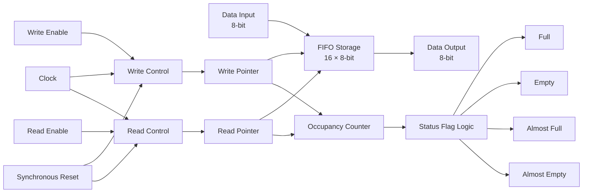
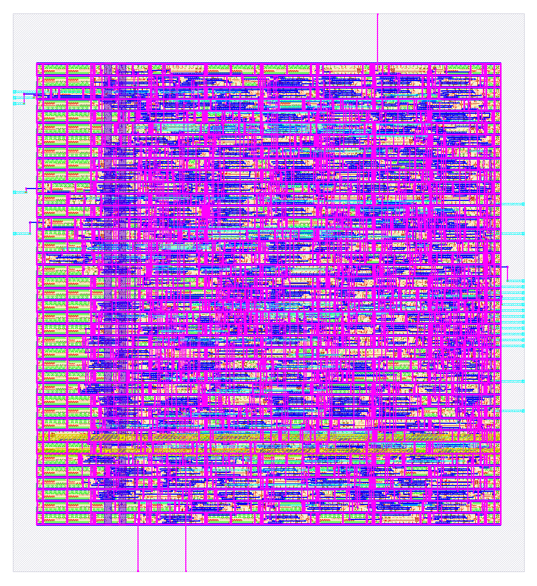

# Synchronous FIFO – ASIC Design and Physical Implementation

## Overview

A parameterized synchronous FIFO designed using Verilog RTL and implemented through an open-source ASIC design flow using the SKY130A PDK.

## Design Specifications

| Parameter | Value |
|---|---|
| Data Width | 8 bits |
| FIFO Depth | 16 |
| Address Width | 4 bits |
| Clock | Single clock |
| Reset | Synchronous, active-high |
| Technology | SKY130A |

## Features

- Parameterized FIFO architecture
- Read and write pointer management
- Occupancy counter
- Full and empty flags
- Almost-full and almost-empty flags
- Pointer wrap-around
- Simultaneous read/write handling
- Boundary-condition handling

## FIFO Architecture

The synchronous FIFO consists of a storage array, read and write pointer logic, an occupancy counter and status flag generation logic.



## Tools Used

- Verilog
- Icarus Verilog
- Yosys
- LibreLane
- OpenROAD
- SKY130A PDK
- Magic
- KLayout

## Functional Verification

A self-checking testbench was developed using Icarus Verilog to verify FIFO functionality.

The following scenarios were tested:

- Synchronous reset operation
- Basic write and read operations
- FIFO data ordering
- Empty and full boundary conditions
- Almost-full and almost-empty flag behaviour
- Pointer wrap-around
- Simultaneous read and write when FIFO is partially occupied
- Simultaneous read and write when FIFO is full
- Simultaneous read and write when FIFO is empty

All implemented testbench scenarios passed.

Simulation waveform inspection was performed using GTKWave.

### Running Simulation

```bash
iverilog -g2012 -o simulation/fifo_test rtl/sync_fifo.v tb/tb_sync_fifo.v
vvp simulation/fifo_test
```
## Synthesis Results

SKY130A technology mapping using Yosys:

### Generic Synthesis

A technology-independent netlist was generated for the FIFO RTL.

### SKY130A Technology Mapping

The design was mapped to standard cells from the SKY130A library.

| Metric | Result |
|---|---:|
| Mapped cells | 439 |
| Mapped cell area | 5928.19 µm² |

The mapped netlist is available in `synthesis/sync_fifo_sky130.v`.

## Physical Design Results

Physical implementation performed using LibreLane and OpenROAD.

| Metric | Result |
|---|---:|
| Standard-cell instances | 697 |
| Standard-cell area | 8067.74 um^2 |
| Core area | 11320.9 um^2 |
| Die area | 15132.3 um^2 |
| Utilization | 71.26% |
| Worst setup slack | +11.4787 ns |
| Hold slack | +0.1123 ns |
| Estimated total power | 1.3247 mW |
| DRC errors | 0 |
| LVS errors | 0 |

Power is an implementation estimate, not a silicon measurement.

## Final Physical Layout

The FIFO design was implemented through the RTL-to-GDSII flow using LibreLane and OpenROAD with the SKY130A PDK.

The final layout includes standard-cell placement and routed interconnections.



Final GDSII: `physical_design/results/sync_fifo.gds`

## Remaining Electrical Warnings

The initial implementation reports:

- 27 maximum-slew violations at max_ss_100C_1v60
- 1 maximum-fanout violation
- 0 maximum-capacitance violations

Additional floating-net and unannotated clock-load reports are documented in the implementation results.

These issues require further investigation before claiming completely clean electrical signoff.

## Repository Structure

- `rtl/` – Verilog RTL
- `tb/` – Testbench
- `simulation/` – Simulation files
- `synthesis/` – Synthesized netlists and reports
- `physical_design/` – Configuration and physical-design results
- `docs/` – Additional documentation

## Project Status

- RTL implementation completed
- Functional testbench suite passed
- Generic and SKY130A synthesis completed
- Physical implementation completed
- GDSII generated
- DRC and LVS reported zero errors
- Remaining electrical warnings documented

## RTL-to-GDSII Flow

The design was taken through the following implementation stages:

1. Verilog RTL design
2. Functional verification using Icarus Verilog
3. Generic synthesis using Yosys
4. SKY130A technology mapping
5. Floorplanning and placement
6. Clock tree synthesis
7. Global and detailed routing
8. Physical verification using Magic and KLayout
9. Final GDSII generation

## Future Work

- Investigate remaining slew and fanout violations
- Improve physical implementation
- Perform further verification and timing analysis
